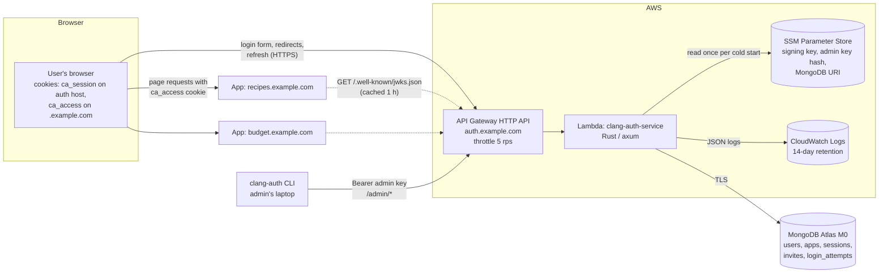
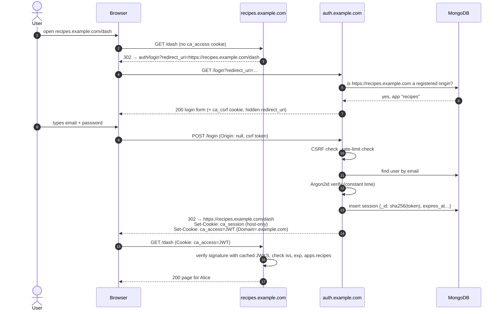
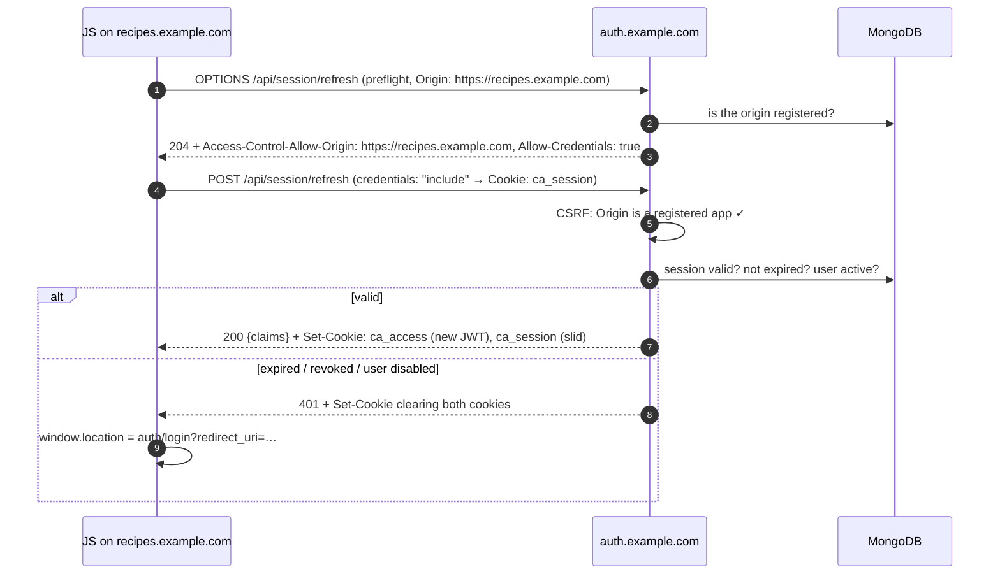
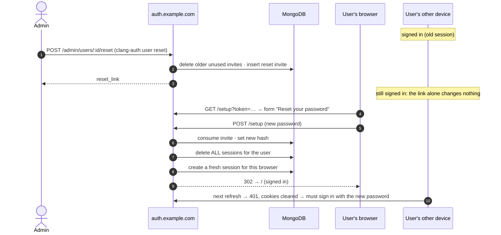
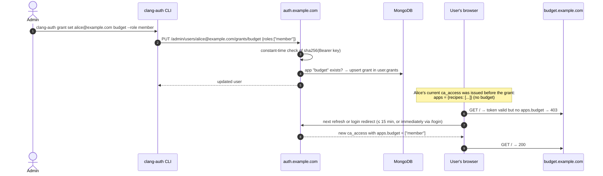

# How clang-auth works

This document explains what the service does and **why**, for someone who knows web development but is new to authentication. Each concept links to the code that implements it. Where the implementation differs from [SPEC.md](../SPEC.md), it says so and links to [DECISIONS.md](../DECISIONS.md).

> **In short**
> - You sign in once at the **auth service** (`auth.example.com`). It remembers you with a 30-day **session** cookie that only it can read.
> - It also gives your browser a 15-minute **access token**: a signed note saying who you are and what you may use. That cookie is shared by every `*.example.com` app.
> - Each app checks the note's signature with a published **public key**. No call to the auth service needed.
> - When the note expires, the app sends you back to the auth service. It sees your session and immediately issues a new note, so you don't see a form.
> - Admins create users and grant access with a CLI. There is no public sign-up.

Contents:

1. [Concepts glossary](#1-concepts-glossary)
2. [Architecture overview](#2-architecture-overview)
3. [Flow walkthroughs](#3-flow-walkthroughs)
4. [Security decisions and threat model](#4-security-decisions-and-threat-model)
5. [Known limitations](#5-known-limitations)
6. [Code map](#6-code-map)

---

## 1. Concepts glossary

**Authentication vs. authorization.** *Authentication* answers "who are you?" (you proved you know the password for `alice@example.com`). *Authorization* answers "what may you do?" (Alice may use `recipes` with role `admin`). clang-auth authenticates users and states their per-app roles in a **grant**. Each app does the authorization: it decides what `admin` means. Grants live on the user document (`crates/core/src/model.rs`, `Grant`). Apps read them from the token's `apps` claim.

**Origin and site.** An *origin* is `scheme://host:port`, such as `https://recipes.example.com`; browsers keep data separate per origin, and clang-auth registers each app by its exact origins (`crates/core/src/origin.rs`). A *site* is broader: all of `*.example.com` is one site. Shared cookies and `SameSite` rules work per site, which is why every app must share one domain. The **auth host** is the auth service's origin, `https://auth.example.com`.

**Session.** Proof that a browser signed in, which lets the user skip typing the password again. Here a session is a random 256-bit token stored in the `ca_session` cookie, which only the auth host can read (see *Origin and site* above). The database stores only its SHA-256 hash (`crates/core/src/store.rs`, `create_session` / `use_session`). Sessions last 30 days and slide forward on each use, up to a hard cap of 90 days. Sessions can be revoked: delete the record and the cookie stops working.

**JWT (JSON Web Token).** A compact, signed JSON document: `header.payload.signature`, each part base64url-encoded. Our access tokens are JWTs whose payload says who the user is and which apps they can use ([SPEC §5.3](../SPEC.md#53-jwt-claims)). Anyone can *read* a JWT. Only the holder of the private key can produce a valid *signature*, so apps can trust the contents without asking the auth service. Built in `crates/service/src/state.rs` (`claims_for`), signed in `crates/core/src/keys.rs` (`SigningKeys::sign`).

**Access token.** The short-lived (15-minute) JWT in the `ca_access` cookie. Because it's short-lived, a stolen or outdated token can't do harm for long, and the service doesn't have to look anything up to accept one.

**Signing vs. encryption.** *Encryption* hides content; only the key holder can read it. *Signing* proves origin and integrity: anyone can read it, but only the key holder could have produced it, and any change breaks the signature. Our tokens are signed, **not** encrypted. Don't put secrets in claims.

**Public/private keys.** Asymmetric cryptography uses a key pair. The **private** key (kept secret, in SSM) creates signatures. The **public** key (published) verifies them. We use **ES256**: ECDSA on the P-256 curve with SHA-256. Its keys are small, signing is fast, and it's widely supported (`crates/core/src/keys.rs`). Compared with a shared secret (HMAC), an app that can verify tokens can't also *forge* them.

**JWKS (JSON Web Key Set).** A JSON document listing public keys, served at `/.well-known/jwks.json` (`crates/service/src/routes/api.rs`, `jwks`). Each key has a **`kid`** (key ID). Every token's header names the `kid` that signed it, so verifiers pick the right key, and keys can be rotated by publishing old and new keys side by side. Our `kid` is the key's RFC 7638 thumbprint ([D16](../DECISIONS.md)).

**Cookie attributes** (`crates/service/src/cookies.rs`):
- **`HttpOnly`**: JavaScript can't read the cookie, so an XSS bug in an app can't steal tokens.
- **`Secure`**: only sent over HTTPS, so it can't be sniffed on café Wi-Fi. Turned off only for local `http://` dev (`COOKIE_SECURE=false`).
- **`SameSite=Lax`**: the browser sends the cookie on requests from the same *site* (`*.example.com` counts as one site), and on top-level navigations from elsewhere, but not on cross-site POSTs or background requests. This is the main CSRF defence.
- **`Domain`**: with no `Domain` (our session cookie), the cookie is **host-only**: sent only to `auth.example.com`. With `Domain=.example.com` (our access-token cookie), it's sent to every subdomain, which is how every app receives the token.
- **`Max-Age`**: how long the browser keeps it.

**CORS (Cross-Origin Resource Sharing).** By default, JavaScript on `recipes.example.com` may *send* a request to `auth.example.com` but may not *read* the response. The server opts in with `Access-Control-Allow-Origin: https://recipes.example.com` and, for cookies, `Access-Control-Allow-Credentials: true`. We only ever echo **registered app origins**, never `*` (`crates/service/src/security.rs`, `cors_origin`).

**CSRF (Cross-Site Request Forgery).** A malicious page makes *your* browser submit a form to a site where you're signed in, and the browser helpfully attaches your cookies. Defences here are `SameSite=Lax` cookies, an `Origin`/`Referer` check on every state-changing POST, and a double-submit token for our own forms (`csrf_check` in `security.rs`; see [§4](#csrf-protection-spec-61)).

**Open redirect.** A login page that redirects to whatever `?redirect_uri=` says can be abused: `auth.example.com/login?redirect_uri=https://evil.com` looks trustworthy in a phishing email and then lands on the attacker's site, sometimes with tokens attached. We only redirect to origins registered for an app (`crates/core/src/origin.rs`, `parse_redirect`; `crates/service/src/routes/browser.rs`, `resolve_target`).

**Password hashing vs. encryption.** Encrypted passwords can be decrypted by whoever has the key. *Hashed* passwords can't be reversed at all. To check a login, you hash the attempt and compare. A good password hash is **slow** and uses a random **salt**, so a stolen database can't be cracked at scale or with precomputed tables.

**Argon2id.** The password hash we use. It's memory-hard (each guess needs 19 MiB of RAM, which defeats cheap GPU and ASIC cracking) and is the OWASP recommendation. Parameters are stored inside each hash string (`$argon2id$v=19$m=19456,t=2,p=1$…`), so they can be raised later without breaking old hashes (`crates/core/src/password.rs`).

**Rate limiting.** Capping attempts so passwords can't be guessed quickly: 5 failures per email or 20 per IP in 15 minutes, after which even the correct password is refused until the window ends (`login_attempts` collection; `login_submit` in `browser.rs`).

**Token revocation.** Making an issued credential stop working before it expires. Sessions are revocable: delete the record. Access tokens are **not**: apps verify them offline, so nothing tells them a token was revoked. This is the standard trade-off of stateless tokens, which is why access tokens live only 15 minutes.

**Bearer token.** A secret that grants access to whoever presents ("bears") it, with no further proof. Session cookies, access tokens, invite links and the admin API key (`Authorization: Bearer …`) are all bearer tokens, which is why the service stores only their hashes and never logs them.

**Cold start.** AWS Lambda starts a fresh copy of the service (a *container*) when none is free. The first request to a new container waits for startup: here, reading secrets from SSM and connecting to MongoDB (`crates/service/src/main.rs`). Later requests reuse the warm container. Secrets are therefore only re-read when containers are replaced.

**Invite.** A single-use, 72-hour link (`/setup?token=…`) used both for first-time password setup and for admin-initiated resets. Stored as a SHA-256 hash (`create_invite` / `consume_invite` in `store.rs`).

---

## 2. Architecture overview



Key points:

- **Apps never call the auth service per request.** They verify `ca_access` locally against cached public keys. The auth service only sees logins, refreshes (about one per active user every 15 minutes), JWKS fetches (hourly per app instance), and admin calls. That's why it's cheap.
- **The CLI uses HTTP, not the database.** The admin key travels as a bearer token over TLS. The service stores only its hash.
- **One binary, two runtimes.** `crates/service/src/main.rs` checks `AWS_LAMBDA_RUNTIME_API`. In Lambda it runs the axum router through `lambda_http`; otherwise it runs the same router as a normal server on port 4000.
- **Secrets are read once per container** from SSM, and the MongoDB client is created once and reused across invocations.

---

## 3. Flow walkthroughs

In the diagrams, *Auth* is `auth.example.com`, *App* is an app such as `recipes.example.com`, and *DB* is MongoDB.

### 3.1 First login



1. The app sees no valid token and sends the browser to the auth service, saying where to come back to.
2. The auth service validates `redirect_uri` *before* anything else: it must be an absolute URL whose origin exactly equals a registered app origin. Anything else (unknown host, `//evil.com`, `javascript:`) is quietly replaced with the auth home page `/`.
3. On POST, the service checks the request came from a trusted page (CSRF), that the email and IP aren't rate-limited, and then the password. Unknown email, wrong password, disabled account: all get the same "Invalid email or password".
4. On success it creates a session (only the hash is stored), sets both cookies, and redirects back. If the user has no grant for `recipes`, it shows "You don't have access to Recipes" instead and stays signed in.
5. The app verifies the token itself. No call to the auth service.

Code: `login_form`, `login_submit`, `signed_in` in `crates/service/src/routes/browser.rs`.

### 3.2 Login when already signed in to another app

```mermaid
sequenceDiagram
    autonumber
    participant B as Browser
    participant App2 as budget.example.com
    participant Auth as auth.example.com
    participant DB as MongoDB

    Note over B: has ca_session (from signing in via recipes)<br/>ca_access may be valid or expired
    B->>App2: GET / (Cookie: ca_access=… if still valid)
    alt ca_access valid and apps.budget present
        App2-->>B: 200 (no auth round trip at all)
    else missing/expired
        App2-->>B: 302 → auth/login?redirect_uri=https://budget.example.com/
        B->>Auth: GET /login (Cookie: ca_session)
        Auth->>DB: find session by sha256(token); slide expiry; load user
        Auth-->>B: 302 → https://budget.example.com/<br/>Set-Cookie: fresh ca_access, ca_session
        B->>App2: GET / (fresh ca_access)
        App2-->>B: 200
    end
```

This is the single sign-on behaviour. The `ca_access` cookie is shared by all subdomains, so a second app often works immediately. When it doesn't, the auth service recognises its own session cookie and redirects straight back without showing a form.

### 3.3 Access-token refresh

**By navigation:** exactly the `else` branch above. Any full page load with an expired token bounces through `/login` and comes back with a new one.

**By XHR/fetch** (single-page apps, background API calls):



If the origin isn't registered, the response has no CORS headers and the browser blocks the call. Code: `refresh` and `preflight` in `crates/service/src/routes/api.rs`.

### 3.4 Logout

```mermaid
sequenceDiagram
    autonumber
    participant B as Browser
    participant Auth as auth.example.com
    participant DB as MongoDB
    participant App as recipes.example.com

    B->>Auth: POST /logout (form from App: Origin https://recipes.example.com,<br/>redirect_uri=https://recipes.example.com/)
    Auth->>Auth: CSRF check (registered origin ✓)
    Auth->>DB: delete session sha256(ca_session)
    Auth-->>B: 302 → https://recipes.example.com/<br/>Set-Cookie: ca_session=; Max-Age=0<br/>Set-Cookie: ca_access=; Domain=.example.com; Max-Age=0
    B->>App: GET / (no cookies)
    App-->>B: 302 → auth/login…
```

Logout ends **this** session only. A phone that's also signed in stays signed in. To sign someone out everywhere, an admin runs `clang-auth session revoke`. A copy of the access token taken *before* logout (for example from another tab's request) still verifies until it expires.

### 3.5 Invite and first-time setup

```mermaid
sequenceDiagram
    autonumber
    actor Admin
    participant CLI as clang-auth CLI
    participant Auth as auth.example.com
    participant DB as MongoDB
    actor New as New user
    participant B as New user's browser

    Admin->>CLI: clang-auth user create sam@example.com --grant recipes:member
    CLI->>Auth: POST /admin/users (Bearer admin key)
    Auth->>DB: insert user (password_hash: null)
    Auth->>DB: delete earlier unused invites; insert invite {_id: sha256(token), expires_at: +72h}
    Auth-->>CLI: {user, setup_link: https://auth…/setup?token=…}
    Admin-->>New: sends the link (chat, email…)
    New->>B: opens link
    B->>Auth: GET /setup?token=…
    Auth->>DB: invite exists, unused, not expired?
    Auth-->>B: set-password form (Referrer-Policy: no-referrer)
    B->>Auth: POST /setup (token, password, confirm, csrf)
    Auth->>Auth: policy: 12–128 chars · Argon2id hash
    Auth->>DB: atomically mark invite used (fails if already used)
    Auth->>DB: set password_hash · revoke existing sessions · create session
    Auth-->>B: 302 → / + both cookies (signed in)
```

The raw token exists only in the link. The database holds its hash, so a database leak can't be used to claim pending invites. The page sends `Referrer-Policy: no-referrer`, so if it ever linked elsewhere, the token in the URL wouldn't leak through the `Referer` header.

### 3.6 Password reset



Revoking every session on reset matters: if the reset happened because someone else knew the password, their sessions end too.

### 3.7 An admin granting access



Grants are read from the database each time a token is issued, so changes take effect on the next token, within 15 minutes. Visiting `auth…/login?redirect_uri=<app>` gets one immediately.

---

## 4. Security decisions and threat model

The threats in scope: a phishing site, a malicious web page the user visits while signed in, someone guessing passwords, a stolen database backup, a stolen cookie, and a leaked key. Out of scope: a compromised app server (it sees tokens by design), and the admin's laptop being compromised.

### Redirect validation (SPEC §4.2)

- **Prevents:** open redirects. Without validation, `auth.example.com/login?redirect_uri=https://evil.com` would send freshly logged-in users to a phishing page that looks like the next step of a trusted flow.
- **How:** `redirect_uri` must be an absolute URL whose origin **exactly equals** a registered origin. Anything else falls back to `/`. Specifically:
  - No prefix matching: `https://recipes.example.com.evil.com` *starts with* the right text but is a different host.
  - Rejected outright: `//evil.com` (no scheme), `javascript:` and `data:` URLs, and URLs with credentials. `https://recipes.example.com@evil.com` actually goes to `evil.com`.
  - The service redirects to its own clean re-write of the parsed URL, never the raw input, so the browser can't read the URL differently from how the service checked it ([D14](../DECISIONS.md)).
- **Trade-off:** each app must register every origin it serves from, including `www.` variants.

### Session cookie vs. access-token cookie (SPEC §5)

- **Prevents:** long-lived credentials being exposed to apps. The **session** (powerful, 90 days) is host-only on the auth host. Apps never receive it, so a buggy or compromised app can't steal it. Apps get only the **access token**, which is short-lived and can't be refreshed without the session.
- **`HttpOnly`** on both: XSS in any app can't read them. **`Secure`**: no plaintext leakage. **`SameSite=Lax`**: cross-site pages can't make the browser send them on POSTs.
- **Without it:** one cookie for everything would mean any app bug leaks a 90-day credential.
- **Trade-off:** all apps on the domain share one access-token cookie, so any app can read the token that is valid for the others (it states all of a user's grants, [D15](../DECISIONS.md)). Apps on the domain are trusted to that extent.

### Only hashes in the database

- **Prevents:** a database leak turning into account takeover. Session and invite tokens are stored as SHA-256 hashes, so the attacker can't recover the cookie or link. SHA-256 is fine here, unlike for passwords, because the tokens are 256 random bits and can't be guessed. Passwords use Argon2id because humans pick guessable ones. The admin key is stored as a hash in config, never in plaintext.

### Short-lived, unrevocable access tokens

- **Gives:** apps verify offline, which makes them fast, cheap, and still working if the auth service is briefly down.
- **Costs:** "Access tokens can't be revoked early. Worst case: 15 minutes of access after a revoke." Disabling a user, removing a grant, or signing out doesn't affect a token already issued. To shrink the window, lower `ACCESS_TOKEN_TTL`; you pay for it with more refreshes.

### Signing keys and rotation

- **Prevents:** forged tokens. ES256 means apps hold only public keys, so even a compromised app can't mint tokens. Verifiers also pin `algorithms: ["ES256"]`. Otherwise an attacker could relabel a forged token as unsigned (`alg: none`) or as using a different algorithm, and a careless library might accept it.
- **Rotation:** JWKS publishes active and retired keys, so rotating causes no one being signed out ([operations.md §4](operations.md#4-rotating-the-signing-key)). If the key leaked, drop the old one immediately; forged tokens stop verifying once apps re-fetch the JWKS (cached at most 1 hour).

### CSRF protection (SPEC §6.1)

- **Prevents:** a malicious page making your browser log you out, log you in *as the attacker* (login CSRF), or refresh tokens on its behalf.
- **How:** every state-changing POST checks `Origin` (or `Referer` if there's no `Origin`) against the auth host and registered app origins. A foreign origin is always rejected. `SameSite=Lax` cookies add a second layer.
- **Deviation ([D11](../DECISIONS.md)):** our pages send `Referrer-Policy: no-referrer` (required by §11), and browsers then send **`Origin: null`** on that page's own form submissions. Rather than weaken the referrer policy, forms on the auth host carry a hidden token that must match a `SameSite=Strict` cookie (`ca_csrf`). Requests with no usable origin are accepted only with that token, which a cross-site page can't obtain.
- **Trade-off:** one extra cookie.

### CORS restricted to registered origins (SPEC §4.3)

- **Prevents:** any website's JavaScript calling `/api/session/refresh` or `/api/me` with your cookies and reading your identity. If the service echoed back any origin that asked, any website could silently find out who you are while you browse it.

### Generic login errors, timing, and rate limiting (SPEC §6.1, §11)

- **Prevents:** account enumeration and password guessing. "Invalid email or password" is identical for an unknown email, a wrong password, a disabled account, or an unfinished setup. Unknown emails still run one Argon2 verification against a dummy hash, so response time doesn't reveal which case it was ([D18](../DECISIONS.md)).
- **Rate limits:** 5 failures per email or 20 per IP within 15 minutes block further attempts, **even with the correct password**. Otherwise an attacker could keep guessing and would learn the moment they hit the right one. Limited and unlimited responses look the same.
- **Trade-off:** someone who knows your email can lock you out for 15 minutes by failing 5 times. The window is short, and the IP limit throttles bulk guessing across many accounts. The IP comes from API Gateway, never from a client-supplied `X-Forwarded-For` ([D17](../DECISIONS.md)).

### Invites (SPEC §4.5)

- Single use (atomically consumed, so a double submit can't succeed twice), expiring (72 h), and superseded by newer invites, so a forwarded or old link has a short, well-defined life. Resets revoke all sessions so an attacker who knew the old password is kicked out.
- **Trade-off:** there's no email delivery. The admin passes the link along by hand, so the channel you choose (Signal or similar) is part of the security.

### Password policy

12–128 characters with no composition rules, following NIST SP 800-63B: length matters more than symbols, and arbitrary rules push people towards predictable patterns. The 128 maximum bounds hashing work.

### HTML security headers (SPEC §11)

`Content-Security-Policy: default-src 'none'; style-src 'self'; …` means the pages can't run any script, so an injection bug can't become XSS. `X-Frame-Options: DENY` and `frame-ancestors 'none'` prevent clickjacking (our login form in an invisible iframe). `Cache-Control: no-store` keeps auth pages out of shared caches. `Referrer-Policy: no-referrer` keeps the invite token in `/setup?token=…` out of `Referer` headers. All templates HTML-escape every interpolated value (`html::esc`).

### Admin API key

A single bearer key, compared in constant time against its stored SHA-256 hash, so timing doesn't leak how many characters matched. **Trade-off:** there is no per-admin identity or scoping. Anyone with the key is the admin. Rotation is in [operations.md §5](operations.md#5-rotating-the-admin-api-key).

### Logging hygiene

Passwords, tokens, links, session IDs, and the admin key are never logged. Request logs omit query strings because the setup link's token is in one. A test captures all logs during the login and invite flows and fails if any secret appears (`crates/service/tests/logs.rs`).

### Cost as a security property

A pay-per-request service can be attacked through your wallet. The API Gateway throttle (5 rps), Lambda reserved concurrency (5), and kill switch bound the worst case at about $25/month ([operations.md §3](operations.md#3-cost-guardrails-and-the-kill-switch)). The trade-off is that a flood of requests can deny service to real users; for a personal service that's accepted.

---

## 5. Known limitations

What this service intentionally does **not** do ([SPEC §1 Non-Goals](../SPEC.md#non-goals-mvp)):

- **Not an OAuth 2.0 / OpenID Connect provider.** No authorization-code flow, client secrets, or discovery document. Only apps on subdomains of one domain can use it, because the whole design relies on a shared parent-domain cookie.
- **No MFA, passkeys, or social login.** A password is the only factor.
- **No email.** Invites and resets are links the admin delivers by hand. There's no "forgot password" button.
- **No self-service sign-up or admin web UI.** Everything administrative goes through the CLI and one admin key.
- **No early revocation of access tokens.** Up to 15 minutes of access after logout, disable, or grant removal.
- **No high availability beyond Lambda's defaults,** a single region, and a free-tier database with no backups.
- **No per-admin accounts or audit trail of *who* made a change,** only that the admin key did.

Signs you've outgrown it:

- You need apps outside the root domain (a customer's domain, a mobile app, a third-party integration): you need OIDC.
- You need instant revocation (regulated data, shared devices): consider token introspection or much shorter tokens.
- More than one person administers users: you need individual admin identities, roles, and an audit log.
- Users expect self-service password recovery, MFA, or passkeys.
- You need an SLA: multi-region, paid database tier, backups, monitoring.

At that point a managed identity provider (Cognito, Auth0, Clerk, or similar) or a self-hosted one (Keycloak, Authentik, Ory) is likely a better fit than extending this one.

---

## 6. Code map

| File | Responsibility |
|---|---|
| `crates/core/src/model.rs` | MongoDB document types (`User`, `Grant`, `App`, `Session`, `Invite`, `LoginAttempts`); slug and email validation |
| `crates/core/src/store.rs` | All database access: index creation, apps/users/grants CRUD, sessions (create, slide, revoke), invites (create, peek, atomic consume), rate-limit counters |
| `crates/core/src/password.rs` | Argon2id hashing and verification, OWASP minimum parameters, password policy, dummy verification for timing |
| `crates/core/src/secret.rs` | CSPRNG tokens, SHA-256 hashing, constant-time hash comparison (admin key) |
| `crates/core/src/keys.rs` | ES256 key parsing and generation, `kid` thumbprints, JWKS document, JWT signing, retired keys |
| `crates/core/src/origin.rs` | Origin normalisation and `redirect_uri` parsing (open-redirect defence) |
| `crates/core/src/duration.rs` | `15m` / `72h` / `30d` parsing |
| `crates/service/src/config.rs` | Environment configuration (SPEC §9), validation, SSM resolution at cold start |
| `crates/service/src/state.rs` | Shared state (config, store, keys); building claims and issuing access tokens |
| `crates/service/src/lib.rs` | The axum router: every route, admin auth layer, response middleware |
| `crates/service/src/routes/browser.rs` | `/`, `/login`, `/logout`, `/setup`: the browser flows, rate limiting, redirect validation |
| `crates/service/src/routes/api.rs` | `/api/session/refresh`, `/api/me`, CORS preflight, JWKS, `/health` |
| `crates/service/src/routes/admin.rs` | `/admin/*`: bearer-key middleware and all admin endpoints, including the dev-only token mint |
| `crates/service/src/security.rs` | CSRF origin/token check and CORS helpers |
| `crates/service/src/cookies.rs` | Reading cookies and building every `Set-Cookie` (§5 attributes) |
| `crates/service/src/html.rs`, `static/style.css` | Server-rendered pages, HTML escaping, security headers (CSP, framing, referrer, caching) |
| `crates/service/src/client.rs` | Client IP (API Gateway source IP or socket peer) and user agent |
| `crates/service/src/logging.rs` | JSON logging, per-request span with request ID, no query strings |
| `crates/service/src/seed.rs` | Idempotent local dev data |
| `crates/service/src/main.rs` | Lambda vs. local entrypoint; `seed`, `migrate`, and key-generation subcommands |
| `crates/cli/src/main.rs`, `client.rs`, `output.rs` | The `clang-auth` admin CLI: commands, HTTP client and config, human/JSON output |
| `crates/service/tests/*.rs` | Acceptance tests against real MongoDB: auth flow, tokens, invites, admin, log hygiene, SAM template, repo secrets |
| `crates/cli/tests/e2e.rs` | CLI end-to-end against a live local service |
| `examples/node-app/` | Example consumer: `src/auth.ts` (middleware), tests with throwaway keys and against the live service |
| `infra/template.yaml`, `samconfig.toml` | AWS deployment with cost guardrails |
